**English** · [Nederlands](README.nl.md)

<div align="center">

# Open CalcSheet Studio

**Structural calculations you can read back: every result shows its formula, numbers and units, and all your sheets end up in one report.**

[](https://github.com/OpenAEC-Foundation/Open-CalcSheet-Studio/releases)
[](https://github.com/OpenAEC-Foundation/Open-CalcSheet-Studio/actions/workflows/ci.yml)
[](#license)
[](#screenshots)

### [Download](https://github.com/OpenAEC-Foundation/Open-CalcSheet-Studio/releases)

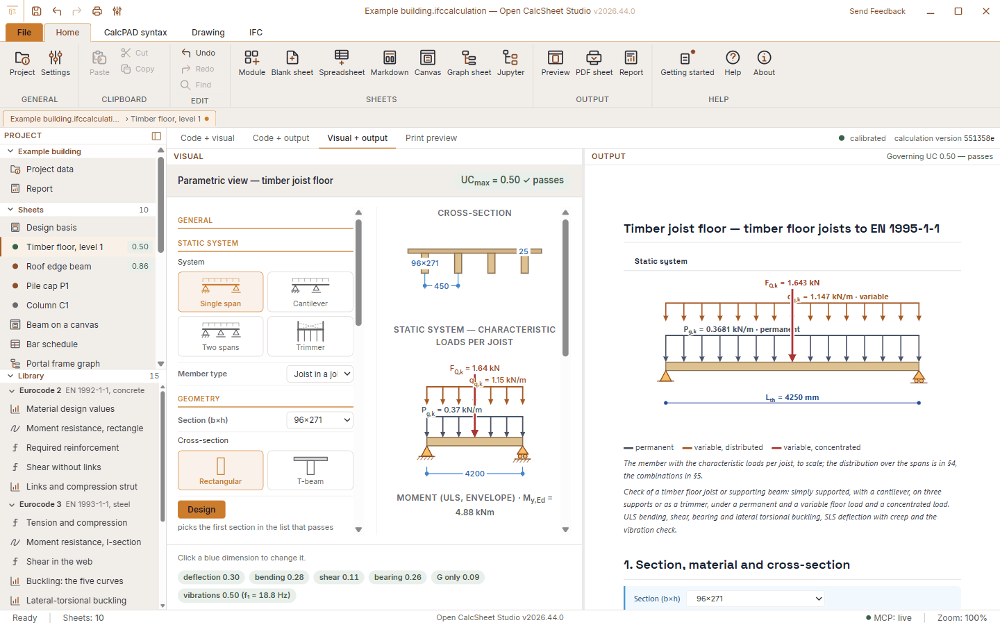

</div>

Open CalcSheet Studio is a desktop app for structural engineers. You write a calculation as text, line by line, and the app works it out with units, in readable formulas. Next to those calculation sheets, a project can hold spreadsheets, formula canvases, node graphs, drawings, Jupyter notebooks, Markdown and PDF files. Together they become one report.

It runs on Windows, macOS and Linux. It is under active development: see [Current limitations](#current-limitations).

## Try it

[Download the app](#download-1), open it and choose **Module**, then **Timber joist floor**. Change the section or the span and watch the unity check follow. Then open **Print preview** to see the sheet on paper.

## Download

There is no stable release yet. The [nightly build](https://github.com/OpenAEC-Foundation/Open-CalcSheet-Studio/releases/tag/nightly) is made from `main` every day.

| Platform | Installer |
|----------|-----------|
| **Windows** | `.exe` installer (x64), for all users or for one user |
| **macOS** | `.dmg` (universal: Apple silicon and Intel) |
| **Linux** | `.deb`, `.AppImage` |

The app has no built-in updater: install a new version over the old one. Your projects are ordinary files and stay where they are.

The release workflow refuses to publish files that are not signed: Windows with Authenticode, macOS with a Developer ID and notarized by Apple, Linux with a separate OpenPGP signature (`.asc`). `SHA256SUMS.txt` lists every file. See [how to verify a download](docs/ondertekening.md).

## Why use it?

- **Free and open.** LGPL-3.0. No licence fees, no account.
- **You can check every step.** A result shows its name, formula, filled-in values and outcome, with units.
- **One project, one report.** Cover, table of contents and page numbers run through all sheets, whatever kind they are.
- **The right sheet for each part.** Text, canvas, spreadsheet, node graph, drawing, notebook, Markdown or PDF, side by side in one project.
- **Change a number, the check follows.** Sheets recalculate while you type, and a drawing can take its sizes from the sheet.
- **Your data stays open.** The project file is IFCX, and you can export IFC4x3.
- **Works with an AI assistant.** A built-in MCP server and REST API run on your own computer, behind a token.

## Screenshots

| | |
|---|---|
| 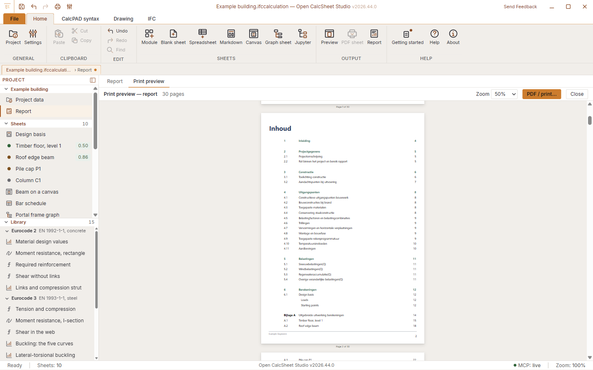 **One report from all sheets** | 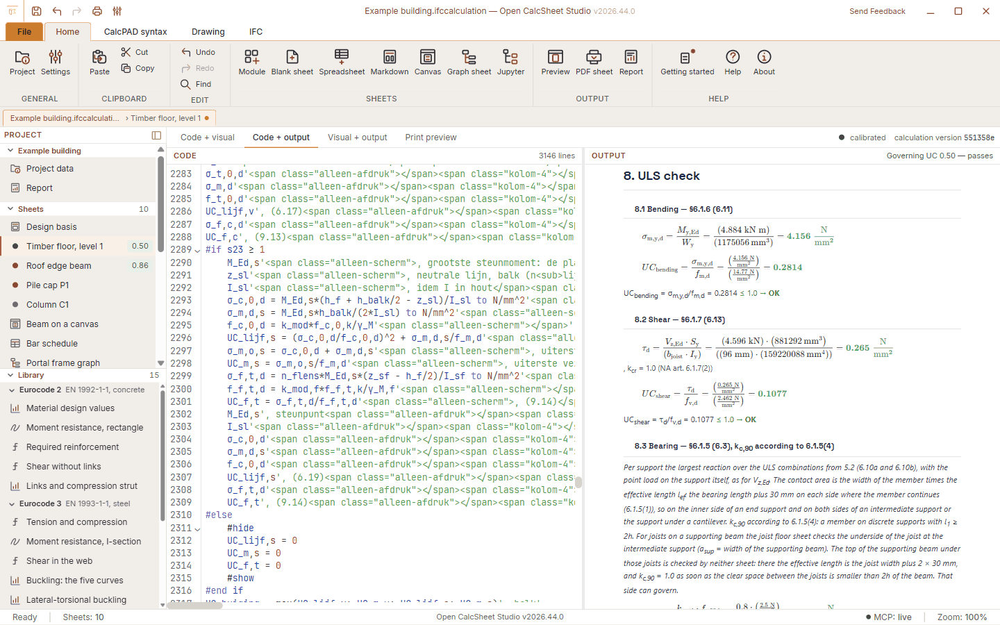 **Text in, formulas out** |
| 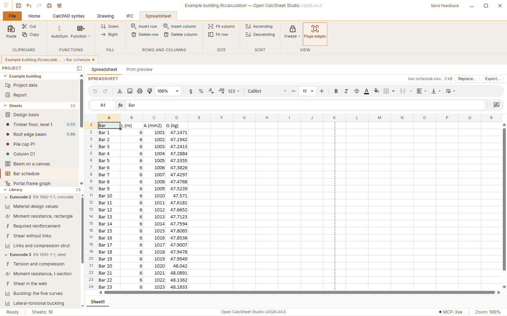 **Spreadsheet** | 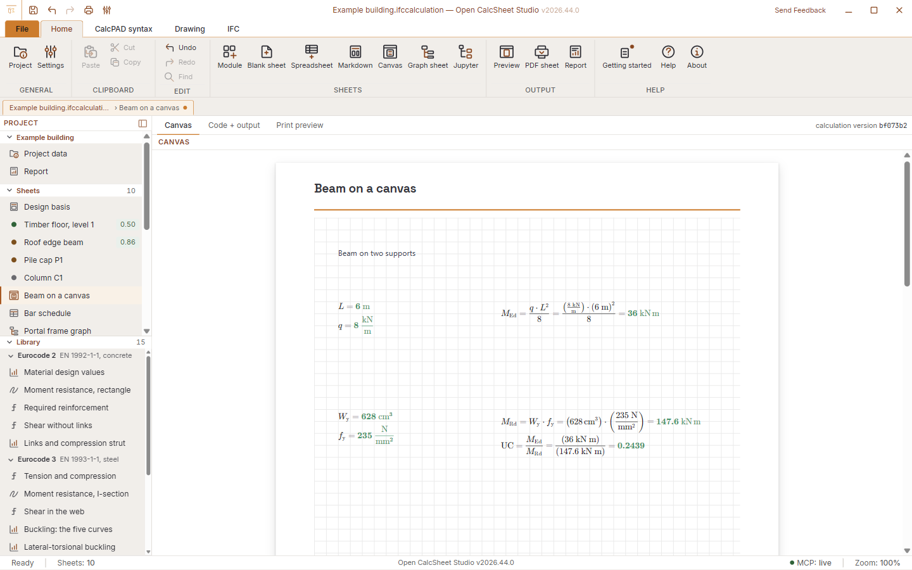 **Formulas on a canvas** |
| 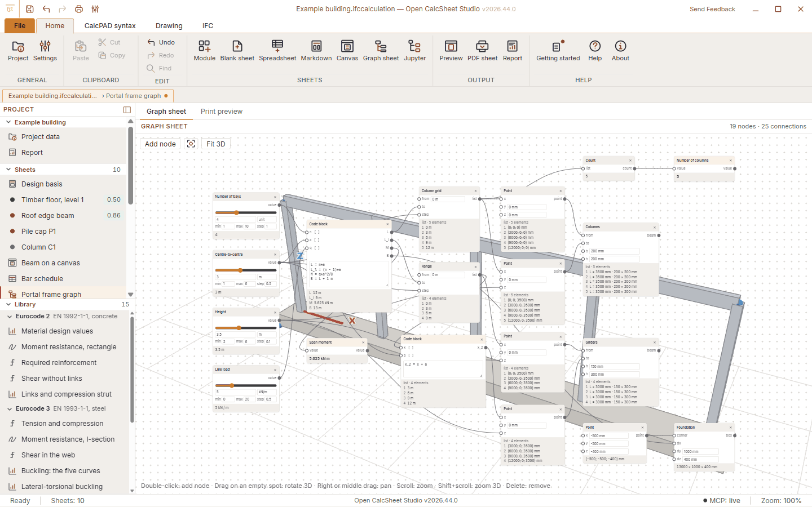 **Node graph with 3D preview** | 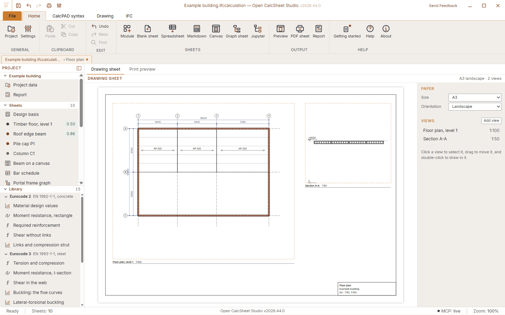 **Drawing sheet with several views** |
| 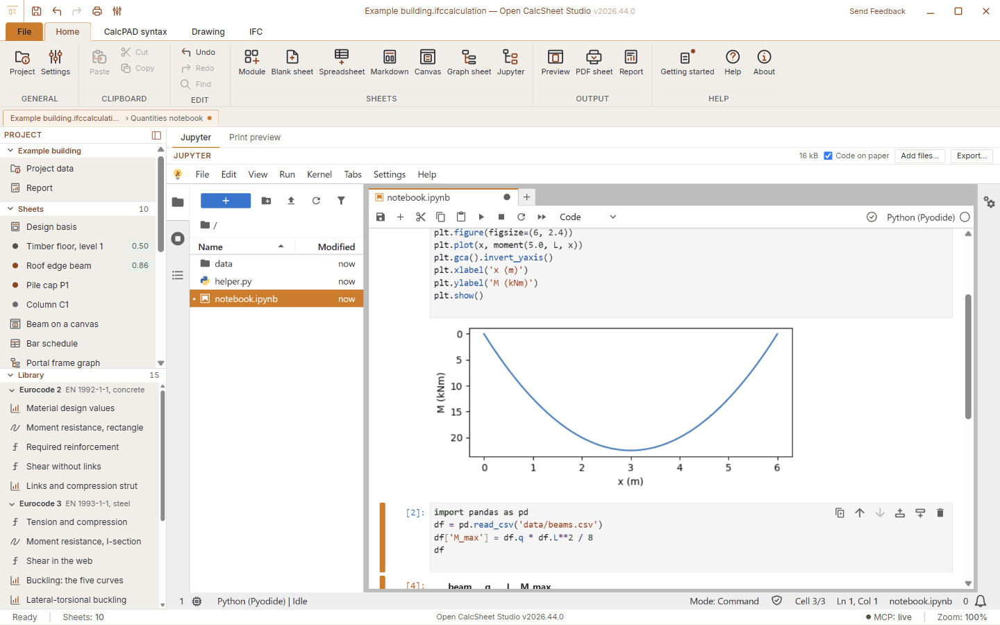 **Jupyter notebook with Python** | 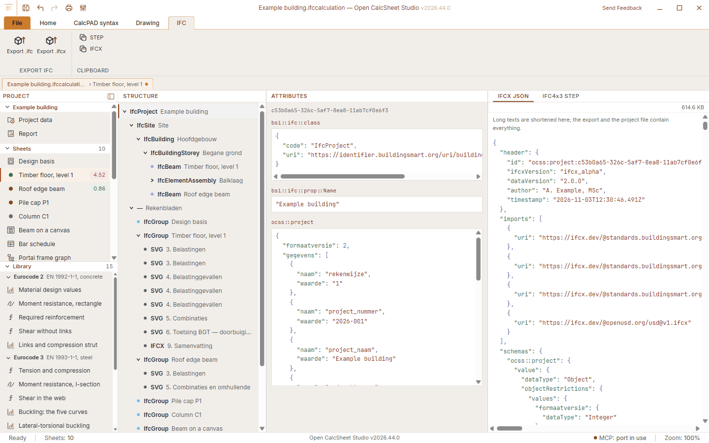 **IFC and IFCX** |

## Sheets

A project is a list of sheets. Each kind has a chapter in [the sheet kinds documentation](docs/bladsoorten.md).

| Sheet | What it is |
|-------|------------|
| **Calculation sheet** | Text in the [calculation language](docs/rekentaal.md), with formulas, conditions, plots and drawings |
| **Spreadsheet** | An `.xlsx` workbook with formulas, cell pointing, fill and page edges |
| **Canvas** | Formula units placed freely, calculated top to bottom with the same kernel |
| **Graph** | Nodes, lists and code blocks, with a 3D preview |
| **Drawing** | A4, A3 or A2 with views to scale: grids, levels, walls, steel sections, hollow-core floors and schemes |
| **Jupyter** | A [notebook with Python](docs/jupyter-blad.md), numpy, scipy, pandas and matplotlib, without installing anything |
| **Markdown, PDF** | Existing text and documents, as part of the report |

## Modules and library

Modules are ready-made sheets with an input screen: a **timber joist floor** and a **beam in timber or steel** to EN 1995-1-1 and EN 1993-1-1, and a **two-pile cap** to EN 1992-1-1, with the Dutch national annex. The [online module library](https://github.com/OpenAEC-Foundation/Open-CalcSheet-Studio-modules) can add modules without a new release; so far it holds the floor. See [how the floor check works](docs/balklaag-toetsing.md) and [the pile cap check](docs/tweepaalspoer-toetsing.md).

The formula library holds 137 formulas you can insert with a click. The library in the project panel adds 15 worked examples from the Eurocodes and classical mechanics. Those examples are not in the installer: the app fetches them from this repository when it starts, so [a correction reaches everyone](docs/library.md) without a new release.

| | |
|---|---|
| 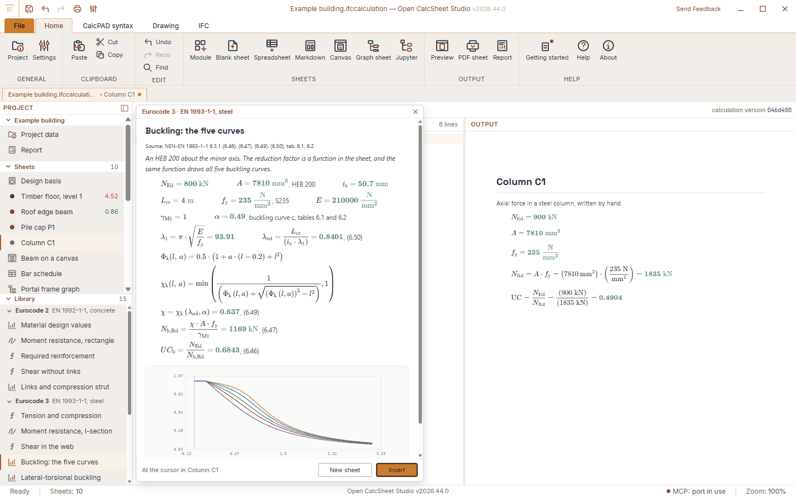 **A worked example from the library** | 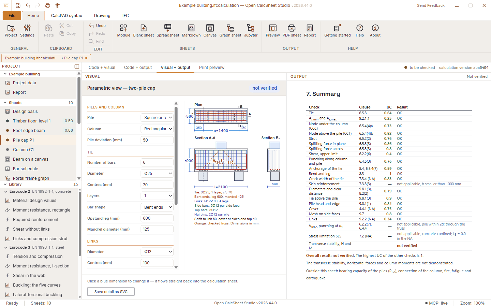 **Two-pile cap with reinforcement drawing** |

## Interoperability

| Format | Open | Save / export |
|--------|------|---------------|
| **IFCX** (`.ifccalculation`, `.ifcx`) | Yes | Yes, this is the project file |
| **IFC4x3** (`.ifc`) | No | Yes |
| **Calculation text** (`.cpd`) | Yes | No, it is saved as the project file |
| **Spreadsheet** (`.xlsx`) | Yes | Yes |
| **Markdown** (`.md`) | Yes | Yes |
| **Notebook** (`.ipynb`, `.py`, data files) | Yes | The work folder as `.zip` |
| **PDF** | As a sheet | Yes, the report |
| **DXF** | Converted to a drawing in a sheet | No |

Every sheet with its text, input and results is in the IFCX file. Drawings that a module's input screen draws are not stored as figures, only what the calculation text draws itself. Most sheets do not know where their part sits in the building, so elements without geometry are placed at the origin of the storey. See [the IFC documentation](docs/ifc-export.md).

## MCP

The app has a built-in MCP server and a REST API with the same 43 tools: open and save projects, add sheets, set input, calculate, export and print. It only listens on your own computer (`127.0.0.1`), behind a token. You can switch it off, make it read-only or pause it under **Settings › API and AI assistant**. See [the MCP documentation](docs/mcp.md) and [the REST API](docs/api.md).

## Testing and reliability

- **53 check scripts** in `scripts/`, run with `npm run check` on every pull request, on Linux and on Windows.
- **121 results against hand calculations**: 53 in `scripts/check-formules.mjs` and 68 in `scripts/check-library.mjs`, the latter where possible along another route, such as checking equilibrium.
- **A real PDF of a mixed project** in `scripts/check-rapport-pdf.mjs`: as many pages as sheets of paper, every page its number, and every line of the table of contents on the right page.
- **Security checks in the real app**, run by hand: `scripts/proef-js-webrtc.mjs` for scripts in a sheet and `scripts/proef-jupyter-venster.mjs` for notebooks. Both use a listening post to count what gets out.
- **Builds on all three platforms** on every push to `main`, with the signatures checked.

Count sources: the files named above and `ls scripts/check-*.mjs`. A module status tells you how far its check has gone: *calibrated* is compared against reference sheets, *to be checked* is not yet.

## Current limitations

- **Check the results yourself.** The beam and the two-pile cap have the status *to be checked*. The app does not replace the judgment of a structural engineer.
- **Jupyter is only tested on Windows.** On macOS and Linux the sheet will probably not start a kernel, because the webview there limits service workers. Saved files and printing do work.
- **Notebooks have no network.** `%pip install` does not work, and libraries that rely on JavaScript in their output (plotly, bokeh, ipywidgets) show nothing. That is a deliberate choice for now.
- **The library needs internet the first time.** Without a connection it stays empty until it has been fetched once. After that it uses the last version.
- **Spreadsheet values do not reach calculation sheets yet.** A spreadsheet stands on its own for now.
- **Report straight to PDF is Windows only.** Other platforms use the print dialog.
- **The report template is in Dutch.** The app and the sheets follow your language, but the cover, the standard chapters and some names in the IFC tree are Dutch for now.
- **Page breaks can differ slightly between screen scales.** At 100% and 150% a few lines can move to another page.
- **No WebRTC in the app.** It is blocked everywhere, so an external page in `@iframe` that needs it will not work.
- **Open FEM Studio projects are not there yet.** The menu item is visible but disabled.

Found something? [Open an issue](https://github.com/OpenAEC-Foundation/Open-CalcSheet-Studio/issues).

## Under the hood

The calculation kernel (`packages/core`) is TypeScript on mathjs and also works [as a package without the app](docs/rekenkern-als-pakket.md). The app is a Tauri 2 shell in Rust with React 19, CodeMirror 6 and KaTeX; notebooks run on JupyterLite and Pyodide. The shared look and icons come from [OpenAEC Blueprint](https://github.com/OpenAEC-Foundation/OpenAEC-Blueprint).

## Contributing

- **Try it on a real project** and report bugs or missing features as an [issue](https://github.com/OpenAEC-Foundation/Open-CalcSheet-Studio/issues/new). Describe what you did, what you expected and what happened.
- **Correct an example.** The [library](library) is plain text; see [how to fix one](docs/library.md).
- **Write code.** Read [AGENTS.md](AGENTS.md) and [the developer notes](docs/ontwikkelen.md), and open a pull request.

## Quick start (developers)

```bash
git clone https://github.com/OpenAEC-Foundation/Open-CalcSheet-Studio.git
cd Open-CalcSheet-Studio
npm ci
npm run tauri:dev --workspace=@openaec/calcsheet-studio
```

Requires Node 24 and Rust, plus Python 3.10 or newer once to build the Jupyter environment. `npm run dev` starts a browser preview that does not need Rust. See [the developer notes](docs/ontwikkelen.md). The images in this README come from `scripts/maak-readme-beelden.mjs`.

Versions follow the OpenAEC scheme `YYYY.W.N`: year, ISO week without a leading zero, and a number within the week that starts at 0, such as `2026.45.0`.

Open CalcSheet Studio is part of the [OpenAEC Foundation](https://github.com/OpenAEC-Foundation) family of apps.

## License

LGPL-3.0. See [LICENSE](LICENSE). The Jupyter environment ships software under its own licences (BSD, MIT, MPL-2.0, PSF): see [its licence list](packages/desktop/jupyter-omgeving/LICENTIES.md).

## Trademarks

Jupyter, Windows, macOS and other product names are trademarks of their owners. Open CalcSheet Studio is an independent project and is not affiliated with, endorsed by or sponsored by them.
