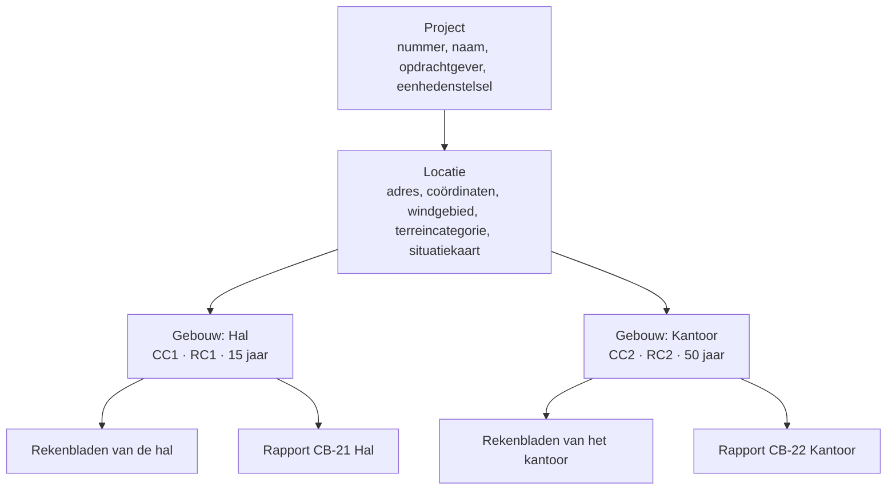

# Rapport op het canvas, met gebouwen in het project — opzet

Datum: 07-11-2026
Status: voorstel, ter bespreking. Nog niet goedgekeurd, dus nog geen plan.

## Waarom

Het constructierapport heeft nu een vaste vorm. H1 tot en met H6 komen uit een
vaste opzet (`rapport/opzet.ts`) en worden ingevuld in een formulier, het
rapportpaneel. Dat werkt voor het standaardrapport, maar:

- **Indeling.** Je kunt een tabel, een schets of een eigen tekst niet ergens
  anders neerzetten. Een eigen blok tussen twee vaste blokken kan ook niet.
- **Lastafdracht.** Er is geen plek voor een lastafdracht zoals "Fundering
  halconstructie": lijnlasten en puntlasten uit de belastinguitgangspunten,
  per strook b × l.
- **Eén gevolgklasse.** Een project heeft één gevolgklasse, één windhoogte en
  één set opbouwen. Een hal (CC1) naast een kantoor (CC2) op hetzelfde terrein
  past daar niet in.
- **Eén rapport.** Een project heeft één rapport. Een tweede rapport, voor een
  ander gebouw of een andere fase, wordt een tweede bestand.

Het canvas (`CanvasBladWeergave`, `legOpVellen`) laat al zien dat vrij plaatsen
op A4-vellen werkt. Dit voorstel trekt dat door naar het hele rapport. De
rapportonderdelen worden daarbij *objecten* die weten wat ze zijn.

## Doelen

1. **Hiërarchie.** Een projectbestand bevat project → locatie → gebouwen, en
   per gebouw rekenbladen en rapporten. Alles staat in één bestand.
2. **Per gebouw.** Per gebouw gelden een eigen gevolgklasse,
   betrouwbaarheidsklasse, ontwerplevensduur en eigen belastinguitgangspunten.
   De rekenbladen van een gebouw rekenen daarmee.
3. **Het rapport op het canvas.** Elk rapport is een canvas van A4-vellen.
   H1 tot en met H6, het voorblad uitgezonderd, bestaan uit objecten die vrij te
   plaatsen, te verwijderen en toe te voegen zijn.
4. **Intelligente objecten.** Een object toont en bewerkt het gegeven zelf, niet
   een kopie ervan. Het weet bij welk gebouw het hoort, wat ervan afhangt en wat
   er niet klopt. Het voorbeeld is de veiligheidsklasse.
5. **Lastafdrachtblok.** Een object voor q-lasten en puntlasten, met per regel
   een keuze uit de belastinguitgangspunten van het gebouw.
6. **Standaardopzet.** Een nieuw rapport begint met de standaardopzet: de huidige
   H1 tot en met H6 als objecten onder elkaar. Wie niets verschuift, krijgt
   hetzelfde rapport als nu.

## Niet-doelen

- Een tekstverwerker. Tekstobjecten krijgen wat het rapport nu kan: alinea's,
  subkoppen, vet, cursief, lijsten en standaardteksten. Opmaak per letter of
  kolommen in een alinea horen er niet bij.
- Rekenbladen zelf op het rapportcanvas zetten. Een rekenblad blijft een blad.
  Het rapport toont zijn samenvatting of zijn uitwerking, zoals nu.
- De geometrie van gebouwen. Een gebouw is hier een verzameling gegevens en geen
  3D-model. Een IFC-model koppelen staat apart op de wensenlijst; die koppeling
  hangt later aan het gebouw uit dit voorstel.

## Anti-doelen (wat het mislukt maakt, ook als het werkt)

- **Twee waarheden.** Hetzelfde gegeven op twee plekken, die uit elkaar kunnen
  lopen: een CC in het rapport en een andere CC in de rekenbladen.
- **Een half systeem.** Een rapportformulier naast een rapportcanvas, waarbij
  sommige dingen alleen in het ene en andere alleen in het andere kunnen. Het
  canvas vervangt het rapportpaneel; het paneel wordt het eigenschappenvenster
  van het gekozen object.
- **Iets kwijt bij het openen.** Een bestaand project dat bij het openen iets
  van zijn rapport of gegevens verliest, of op papier anders uitkomt zonder dat
  iemand iets veranderde.
- **Een lange uitdraai.** Op papier staat het beknopt, de uitleg alleen op het
  scherm. Dat geldt ook voor objecten: een object heeft een schermvorm met
  uitleg en een papiervorm zonder.

## 1. De projectstructuur



Dit is de boom die het IFCX-document al heeft (`ifcx/document.ts`: IfcProject →
IfcSite → IfcBuilding → IfcBuildingStorey). Nu is daar steeds één site met één
gebouw ("Hoofdgebouw"); straks zijn het er meer. Bouwlagen blijven in het model
zoals ze nu zijn en spelen in dit voorstel geen rol.

### Wie is eigenaar van welk gegeven

Elk gegeven heeft precies één eigenaar. Er is geen overerving met
overschrijven: een waarde die op twee niveaus kan staan, is precies het
anti-doel "twee waarheden".

| niveau | gegevens (nu in) |
|---|---|
| Project | projectnummer, -naam, opdrachtgever, constructeur, eenhedenstelsel, rekenwijze (`gegevens`); het bureauprofiel voor een nieuw rapport |
| Locatie | adres, coördinaten, situatiekaart en afstand tot open water (`rapport.situatie`, `locatie`); windgebied, terreincategorie (`gegevens`) |
| Gebouw | naam, onderdeel, soort bouwwerk, nieuwbouw of bestaand met bouwjaar (`uitgangspunten.bestaand`); CC, RC, ontwerplevensduur (`gegevens`); gebouwhoogte, c_s·c_d en windcoëfficiënten (`belastingen.wind`); brandeisen, vervormingseisen, materialen, bevestiging, conservering (`uitgangspunten`); belastingklassen met hun dakhelling, opbouwen en vloervelden (`belastingen.klassen`, `vloerenDaken`, `wanden`, nieuw: `velden`) |
| Rapport | titel, kenmerk, fase, normen, revisies, taal, rol, teksten, de objecten op het canvas; welke bladen erin staan, hun toelichting en of hun uitwerking in het hoofdstuk of in bijlage A staat (`toelichting`, `inHoofdstuk`); de vastgelegde kopie van het bureauprofiel |

**Mijn keuze:** materialen, conservering en vervormingseisen horen bij het
gebouw, niet bij het rapport. Twee rapporten over dezelfde hal mogen elkaar
daarin niet tegenspreken.

**Mijn keuze:** de dakhelling staat bij de dakklasse, zoals nu. Het gebouw krijgt
er geen tweede. De sneeuw rekent per dakklasse met die helling: één dak, één
helling. Een oud bestand rekent de sneeuw nu met een plat dak; dat blijft zo,
tot iemand een sneeuwobject aan een dakklasse koppelt.

**Mijn keuze:** het bureauprofiel blijft per rapport vastgelegd, zoals nu
(`useRapportBureau`). Een opgeleverd rapport verandert dus niet als het profiel
voor een nieuw rapport wordt aangepast.

### Rekenbladen per gebouw

Een rekenblad hoort bij één gebouw (`Exemplaar.gebouw`). Zijn projectscope
(`projectScope`) is die van het project, plus zijn locatie, plus zijn gebouw.
`CC` en `K_FI` in een blad van de hal zijn dus die van de hal.

Een blad zonder gebouw, uit een oud bestand of via de API, valt onder het eerste
gebouw. De projectboom toont de bladen per gebouw.

## 2. Rapporten in het project

- Een project heeft nul of meer rapporten (`rapporten: Rapport[]` in plaats van
  `rapport`). Elk rapport hoort bij één gebouw.
- Een rapport heeft de documentgegevens die het nu heeft: titel, kenmerk, fase,
  revisies en taal. Daarnaast heeft het één canvas met objecten.
- Hoofdstuk Berekeningen toont de bladen van het gebouw van het rapport. Per
  rapport kies je welke bladen erin staan; standaard zijn dat alle bladen van het
  gebouw.
- **Mijn keuze:** een rapport over meer gebouwen tegelijk zit niet in de eerste
  versie. Wie dat wil, maakt per gebouw een rapport. Zie de open punten.

## 3. Het rapportcanvas

Dezelfde mechaniek als het canvasblad, maar op de maten van het rapport:

- **Raster.** De bladspiegel, de regels van 6,6 mm en de 10 kolommen van
  18,98 mm (`MATEN.rapport`). Een object springt in y naar een regel en in x naar
  een kolom. De tabellen van de afdruk zijn al op die kolommen gebouwd. Op 5 mm
  zou de standaardopzet na één verschuiving uit de lijn lopen.
  **Mijn keuze:** de mechaniek van het canvasblad wordt daarvoor met zijn maten
  geparametriseerd. Het rapport krijgt geen tweede kopie ervan.
- **Aanschuiven.** Een object overlapt nooit het object erboven in dezelfde
  kolommen. Groeit een object (een opbouw erbij, een langere tekst, meer
  inhoud), dan schuift wat eronder staat even ver mee. Wordt het kleiner, dan
  blijft wat eronder staat staan. `y` is dus de plek die je koos; waar het op
  papier staat, volgt uit de plek plus het aanschuiven.
  **Mijn keuze:** de standaardopzet en een omgezet oud rapport hebben nog geen
  plekken. Ze staan op volgorde en worden bij het tekenen onder elkaar gezet,
  zoals een gewoon rekenblad op het canvas (`stapelOnderElkaar`). Pas wie iets
  verschuift, legt plekken vast.
- **Breken over de vouw.** Een tekst breekt tussen twee regels, zoals nu: de
  afdruk deelt tekst per regel op (`raster.tsx`). Een tabel breekt tussen twee
  rijen, met zijn kop bovenaan het volgende vel. Een kop gaat mee met het eerste
  stuk eronder. Andere objecten (een kaart, een afbeelding, een
  veiligheidsklasse) blijven heel en beginnen het volgende vel.
- **Wegvallen.** Een object kan een voorwaarde hebben, zoals de opzet nu. Is die
  niet waar, dan staat het object niet op papier en telt het niet mee in de
  nummering. Op het scherm staat het dan doorzichtig, met de reden erbij.
  - Bestaande situatie alleen bij een bestaand gebouw.
  - Blijvende belastingen alleen met opbouwen.
  - Berekeningen alleen met bladen.
  - Een lege tekst valt weg met de kop die erbij hoort.

  **Mijn keuze:** heb je een object verwijderd en wordt de voorwaarde later waar
  (je zet het gebouw op "bestaand"), dan komt het niet vanzelf terug. Het object
  dat de voorwaarde verandert (Bouwwerk) biedt dan aan: "Bestaande situatie
  invoegen".
- **Zoomen** met Ctrl en scrollen, zoals op het canvasblad.

Daarbij komt:

- **Voorblad.** Het voorblad blijft een vaste pagina met de documentgegevens. Het
  is geen canvas. De inhoudsopgave is een object dat je kunt verplaatsen.
- **Koppen zijn objecten.** Een kop (H1, H2 of H3) is een object. Het nummer volgt
  uit de volgorde op het canvas: van boven naar beneden, en per vel van links
  naar rechts, zoals de eenheden op het canvasblad. Verschuif je een kop, dan
  nummert alles opnieuw. De inhoudsopgave leest de koppen met hun paginanummer;
  dat kan nu al (`inhoudsopgave` in `opzet.ts`).
- **Nieuwe pagina.** Een kop kan "begint op een nieuwe pagina" hebben, zoals nu
  `nieuwePagina`. Wat eronder staat, schuift dan naar het volgende vel.
- **Doorlopende objecten.** Een lange tabel (veel opbouwen, veel lastregels, een
  uitwerking in het hoofdstuk) mag over de vouw lopen. Hij breekt tussen twee
  rijen en de kop van de tabel komt bovenaan het volgende vel terug. Andere
  objecten blijven heel en gaan als één blok naar het volgende vel.
- **Kolommen.** Objecten kunnen naast elkaar staan, net als op het canvasblad. De
  standaardopzet zet alles onder elkaar.

## 4. De objecten

Er zijn drie soorten.

### a. Vrije objecten

Ze horen bij het rapport en zijn niet gekoppeld.

| object | inhoud |
|---|---|
| Kop | tekst, niveau, nieuwe pagina ja/nee |
| Tekst | alinea's, subkoppen, lijsten, standaardteksten uit de bibliotheek (`standaardteksten.ts`) |
| Afbeelding | foto, schets of PDF-pagina, met bijschrift |
| Rekentaal | een stuk rekentekst zoals een eenheid op het canvasblad; rekent met de scope van het gebouw |
| Inhoudsopgave | de koppen met paginanummer |

### b. Gekoppelde objecten (de intelligente)

Een gekoppeld object is een venster op een gegeven in het model en bewaart zelf
geen waarde. Het bewaart alleen waar het staat, hoe groot het is, en welk gebouw
of welke locatie het toont. Standaard is dat het gebouw van het rapport.

Elk gekoppeld object heeft:

- **een papiervorm**: de tabel of tekst zoals die nu in de afdruk staat. De
  bestaande onderdelen worden hergebruikt: `Bouwwerk`, `Brand`, `Materialen`,
  `Conservering`, `Factoren`, `Bestaand`, `Vervormingen`, `Sneeuw`, `Wind`,
  `Veranderlijk` en `Groep` in `components/rapport/afdruk`;
- **een schermvorm**: dezelfde tabel, maar bewerkbaar, met uitleg en met
  meldingen;
- **afleidingen**: wat het object uit zijn gegevens berekent;
- **gevolgen**: wat er verandert als je het object bewerkt;
- **controles**: wat er niet klopt.

| object | eigenaar | toont en bewerkt | leidt af | gevolgen | controles |
|---|---|---|---|---|---|
| **Veiligheidsklasse** | gebouw | CC, RC, ontwerplevensduur | K_FI, β (`beta`), DSL (`ontwerpSupervisie`), IL (`inspectieniveau`), referentieperiode | factorentabel, alle bladen van het gebouw (CC, K_FI), toetsing van de ontwerplevensduur | RC lager dan CC; CC3 zonder IL3; een ontwerplevensduur die niet bij het soort bouwwerk past |
| Belastingfactoren | gebouw (afgeleid) | niets, alleen-lezen | γ_G, γ_Q, ψ per combinatie (`belastingfactorTabel`) | — | — |
| Bouwwerk | gebouw | soort bouwwerk, nieuwbouw of bestaand | — | kop "Constructieprincipe" of "Wijziging", paragraaf Bestaande situatie | bestaand zonder bouwjaar |
| Brand | gebouw | brandwerendheid per onderdeel | — | — | — |
| Materialen, Bevestiging, Conservering | gebouw | regels | — | — | een materiaal dat in een blad voorkomt en hier ontbreekt (later) |
| Vervormingseisen | gebouw | u_eind, u_bij, u_hor per onderdeel | — | grenzen voor de bladen (later) | — |
| Sneeuw | dakklasse van het gebouw | de dakklasse en zijn helling | μ_1, s = μ_1·C_e·C_t·s_k | keuzelijst van de lastafdracht | een dak zonder helling |
| Wind | gebouw + locatie | gebouwhoogte, c_s·c_d, coëfficiënten (windgebied en terreincategorie via de locatie) | q_p(z) | windbelasting in de lastafdracht | hoogte ontbreekt |
| Belastingklasse | gebouw | categorie, of een eigen q_k en Q_k met ψ | q_k, Q_k, ψ | keuzelijst van de lastafdracht | — |
| Opbouw | gebouw | lagen (vlak: d × ρ of p; gevel: p × h × vulling) | som in kN/m² of kN/m¹ | keuzelijst van de lastafdracht | een laag zonder waarde |
| Situatie | locatie | kaarten, adres, coördinaten | terreincategorie (voorstel), afstand tot open water | — | — |
| Rol | rapport | rol, architect, datum onderlegger | — | — | — |
| Berekeningen | rapport, met de bladen van het gebouw | welke bladen, hun toelichting, en per blad of de uitwerking hier of in bijlage A staat | per blad UC, oordeel en normen | volgorde en nummers van bijlage A | UC > 1, rekenfout |
| **Lastafdracht** | gebouw | zie §5 | ΣG, ΣQ | waarden voor de rekenbladen (later) | een gekozen uitgangspunt dat niet meer bestaat |

Uitgewerkt voor de **veiligheidsklasse**: je zet het object neer en kiest CC2.
Dat ene gegeven van de hal verandert. Dan gebeurt het volgende:

- de factorentabel eronder springt mee;
- elk blad van de hal rekent opnieuw met K_FI = 1,0;
- in een ander rapport over dezelfde hal staat in zijn veiligheidsklasse-object
  ook CC2.

Kies je daarna RC1, dan meldt het object op het scherm dat RC1 bij CC2 lager is
dan NEN-EN 1990 bijlage B aangeeft. Op papier staat alleen de tabel. Zet je een
tweede veiligheidsklasse-object neer, dan is dat een tweede venster op hetzelfde
gegeven, geen tweede waarde.

**Mijn keuze voor de bladen:** Berekeningen is één samengesteld object dat de
gekozen bladen zelf opsomt, zoals `bladKnopen` nu. Er komt geen los object per
blad. Een nieuw blad van het gebouw komt vanzelf achteraan in elk rapport van
dat gebouw. In het eigenschappenvenster haal je het eruit of verander je de
volgorde. De volgorde van bijlage A is die van het object.

### c. Samengestelde objecten

Een hoofdstuk uit de standaardopzet is een groep objecten: een kop met wat
eronder hoort. Een groep kun je als geheel verplaatsen, verwijderen en opnieuw
invoegen ("H5 Belastingen invoegen"). Je kunt hem ook uit elkaar halen en de
delen los plaatsen.

## 5. Het lastafdrachtblok

Naar het voorbeeld "Belasting uit vloer t.p.v. langs randen":

| q-last | b [m] | l [m] | P_rep [kN/m²] | G | Q |
|---|---|---|---|---|---|
| BG | 1,20 | 1,00 | 6,3 | 7,5 | |
| | 1,20 | 1,00 | 10,0 | | 12,0 |
| Gevel | 1,00 | 8,00 | 0,2 | 1,6 | |
| | | | Σ | 9,1 | 12,0 [kN/m¹] |

- **Soort.** Het blok heeft een titel en is een *lijnlast*: per regel b × 1 m
  (of l), met Σ in kN/m¹. Of het is een *puntlast*: b × l, met Σ in kN.
- **Keuze per regel.** Elke regel kiest een belastinguitgangspunt van het gebouw.
  - Een **vloerveld** combineert een opbouw (G) met een belastingklasse (Q) onder
    één naam, zoals "BG": opbouw Begane grondvloer en klasse opslag 10 kN/m².
    Kies je het, dan komen er twee regels: de G-regel en de Q-regel, zoals in het
    voorbeeld. Heeft de klasse lichte scheidingswanden, dan komt daar een derde
    regel bij (Q).
  - Een **vlakke opbouw** (kN/m², vloer, dak of wand) geeft één G-regel: p × b × l.
    Een wand in kN/m² met l als hoogte is de regel "Gevel" uit het voorbeeld.
  - Een **gevelopbouw** rekent zijn hoogte al mee (q = p × h × vulling, kN/m¹,
    `opbouw.ts`). Die regel is q × l, met l de lengte (standaard 1). b telt niet;
    zo komt de hoogte er niet twee keer in.
  - Een **dakklasse** of **sneeuw** geeft een Q-regel met de q_k of s van dat
    dak.

  **Mijn keuze:** wind zit niet in de eerste versie van het blok. De
  windbelasting hangt af van het vlak en de coëfficiënt; dat is een eigen
  object.
- **Rekenen.** P_rep komt uit het gekozen uitgangspunt en is niet in te typen.
  Wie een andere waarde wil, maakt een ander uitgangspunt. Zo blijft de tabel
  herleidbaar. b en l typ je in, in de eenheden van het project.
- **Sommen per soort.** ΣG is één som. ΣQ is een som per soort veranderlijke
  last, omdat de ψ verschilt: vloer A 0,4/0,5/0,3, dak 0, sneeuw 0. Heeft het
  blok één soort, dan staat er één ΣQ, zoals in het voorbeeld. Heeft het er
  meer, dan krijgt elke soort een eigen regel onder de tabel, met zijn ψ_0.
- **Uitkomst.** ΣG en de ΣQ's hebben een naam (het blok heet bijvoorbeeld
  `q_rand`: `q_rand.G`, `q_rand.Q`). Die zijn te gebruiken in een
  rekentaalobject eronder.
- **Controle.** Wordt een opbouw verwijderd of hernoemd, dan meldt het blok de
  regel en houdt het de laatste waarde vast tot je een keuze maakt.

Daarvoor zijn twee aanvullingen in het model nodig:

- **Vloerveld.** Een nieuw uitgangspunt (`belastingen.velden`: naam, opbouw,
  klasse).
- **Eigen belastingklasse.** Een klasse met een eigen q_k en Q_k. De tabel
  `CATEGORIEEN` heeft nu geen opslag (categorie E), en 10 kN/m² zit er niet in.

## 6. Het eigenschappenvenster

Het rapportpaneel van nu wordt het venster voor het gekozen object. Bij een
veiligheidsklasse toont het dezelfde keuzes als het object op het canvas, met
uitleg. Bij een kop toont het het niveau en "nieuwe pagina". Is er niets
gekozen, dan toont het de documentgegevens van het rapport, de revisies en de
bijlagen.

Het formulier Projectgegevens verdeelt zich over de boom:

- **Project** toont de projectgegevens.
- **Locatie** toont de locatie, met de kaart.
- **Gebouw** toont de gebouwgegevens.

Dezelfde velden zijn ook als object op het rapportcanvas te zetten.

## 7. Opslag, IFCX en oude bestanden

**Projectbestand.** De formaatversie gaat omhoog. In het IFCX-document:

- de locatie op IfcSite, met de gegevens als `ocss::locatie`;
- elk gebouw op IfcBuilding, met `ocss::gebouw` en zijn uitgangspunten en
  belastingen;
- elk rapport als knoop onder zijn gebouw, met `ocss::rapport` en de objecten;
- elk blad met een verwijzing naar zijn gebouw.

**Een object in het bestand:**

```ts
interface RapportObject {
  id: string;
  soort: string;            // "kop", "tekst", "veiligheidsklasse", "lastafdracht", …
  x?: number; y?: number;   // mm op het canvas, y doorlopend over de vellen; leeg = op volgorde
  b?: number;               // breedte in mm; leeg = tot de rechterrand
  doel?: { niveau: "gebouw" | "locatie"; id: string };  // gekoppeld: wat het toont
  instellingen?: Record<string, unknown>;               // per soort: kopniveau, tekst, lastregels, …
}
```

`x` en `y` ontbreken zolang het object nog op volgorde staat (zie
"Aanschuiven" in §3). Een voorwaarde voor wegvallen staat in de soort, niet in
het object.

Een gekoppeld object heeft in `instellingen` alleen hoe het iets toont, nooit
een waarde van het gegeven zelf. Het lastafdrachtblok bewaart zijn regels
(uitgangspunt-id, b, l) in `instellingen`. Die regels zijn van het blok zelf.

**Een oud bestand openen** gaat zonder verlies:

- uit `gegevens` en `rapport` ontstaan één locatie, één gebouw (met de naam uit
  `onderdeel`, of "Gebouw") en één rapport;
- elk gegeven gaat naar zijn eigenaar volgens de tabel in §1;
- het canvas van het rapport wordt de standaardopzet met de teksten, keuzes en
  `nieuwePagina` van het oude rapport;
- het afdrukvoorbeeld moet vel voor vel gelijk zijn aan het oude. Dat bewaakt
  een controlescript met de bestaande proefprojecten.

**Een oudere app en een nieuw bestand.** Nu kijkt een oudere app niet naar de
formaatversie (`leesProjectBestand`, `leesProjectIfcx`). Hij zou een nieuw
bestand gewoon lezen, alles in `ocss::gebouw` en `ocss::locatie` missen (CC
valt terug op 2) en het zo wegschrijven. Daarom gebeurt het volgende, beide
(mijn keuze):
- **Stap 0.** Een release vóór stap 1 laat de app een bestand met een hogere
  formaatversie weigeren, met de melding "gemaakt met een nieuwere versie".
- **Overgang.** Tot die release lang genoeg uit is, schrijft het nieuwe bestand
  ook de oude velden: `gegevens` en `rapport` van het eerste gebouw en het
  eerste rapport. Een oudere app ziet dan het eerste gebouw zoals het was.

### Taal van gedeelde gegevens

De taal hoort bij het rapport. De gegevens van gebouw en locatie zijn gedeeld.
**Mijn keuze:**

- Een meegeleverde tekst in de gegevens (een materiaalregel, een soort
  bouwwerk of een vervormingseis uit de standaard) wordt bewaard als die
  standaard, niet als tekst. Elk rapport toont hem in zijn eigen taal. Zo werkt
  een meegeleverde variant nu al (`tekstTaal`, `taalwissel.ts`).
- Een getal staat in de notatie van het rapport.
- Wat iemand zelf typte, staat er zoals het getypt is. Een rapport in een andere
  taal meldt op het scherm dat de tekst nog vertaald moet worden, zoals nu.
- De kaarten van de locatie worden per rapport getekend, in de taal van dat
  rapport.

## 8. API

De MCP- en REST-tools volgen de boom:
- `building_list`, `building_add`, `building_set`;
- `report_list`, `report_add`;
- `report_objects_get`, `report_object_add`, `report_object_set`,
  `report_object_remove`.

`sheet_add` krijgt een gebouw. `project_get` toont de boom. De bestaande tools
blijven werken op het eerste gebouw en het eerste rapport.

## 9. Volgorde van bouwen

Elke stap is een eigen PR vanaf main en levert iets bruikbaars op.

0. **Weigeren wat nieuwer is.** De app weigert een bestand met een hogere
   formaatversie. Dit gaat in een release uit voordat stap 1 bestanden schrijft.
1. **Gebouwen in het model.** Locatie en gebouwen, de gegevens naar hun
   eigenaar, bladen per gebouw, de scope per gebouw en oude bestanden openen. De
   projectboom krijgt gebouwen. Het rapport is nog het oude, voor het eerste
   gebouw.
2. **Meer rapporten.** `rapporten[]`, elk bij een gebouw, nog met de huidige
   opzet en het huidige paneel.
3. **Het rapportcanvas.** Vrije objecten, koppen met nummering, inhoudsopgave,
   doorlopende tabellen, de gekoppelde objecten met hun papiervorm uit de
   bestaande afdruk, en de standaardopzet. Het paneel wordt het
   eigenschappenvenster. Het oude paneel verdwijnt in dezelfde stap: geen
   tussenvorm.
4. **Intelligentie.** Bewerken op het canvas, afleidingen, gevolgen en
   controles. De veiligheidsklasse gaat eerst.
5. **Lastafdracht.** Vloervelden, eigen belastingklassen en het
   lastafdrachtblok, met benoemde uitkomsten.
6. **Opzet van het bureau.** Een eigen standaardopzet als bestand, met dezelfde
   objecten als de standaardopzet maar in een andere volgorde of met andere
   teksten.

## Open punten

Deze beslissingen veranderen wat er gebouwd wordt:

1. **Rapport en gebouwen.** Kan een rapport over meer gebouwen gaan (één
   rapport voor hal en kantoor samen), of altijd over één gebouw?
2. **Eigenaar van de gegevens.** Klopt de verdeling in §1? Vooral:
   - materialen, conservering en vervormingseisen per gebouw en niet per rapport;
   - windgebied en terreincategorie per locatie;
   - gebouwhoogte per gebouw.
3. **Vloerveld.** Is "BG" één keuze die een G-regel en een Q-regel geeft (§5), of
   kies je G en Q per regel los?
4. **Uitkomsten van de lastafdracht.** Moeten ΣG en ΣQ ook in de rekenbladen te
   gebruiken zijn, bijvoorbeeld via `#id`? Of zijn ze alleen voor het rapport?
5. **Het voorblad.** Blijft het voorblad vast (§3), of moet het ook een canvas
   zijn?

## Aan de bouwer gelaten

- de vorm van het eigenschappenvenster per object;
- hoe een groep objecten op het scherm is te herkennen en uit elkaar te halen;
- de iconen en namen in het menu "Object invoegen";
- de controles die als "later" zijn gemarkeerd.
